# 13.1 KDE 6 桌面环境

KDE Plasma 是一款易于使用的现代化桌面环境，提供外观与操作体验一致的应用程序集合，包括统一的菜单与工具栏、快捷键、配色方案、本地化支持，以及集中式、对话框驱动的桌面配置工具。

KDE 桌面环境借鉴了 Windows 等多种桌面环境的交互范式，二者界面设计有相似之处。~~也可能是 Windows 借鉴 KDE 桌面较多。~~

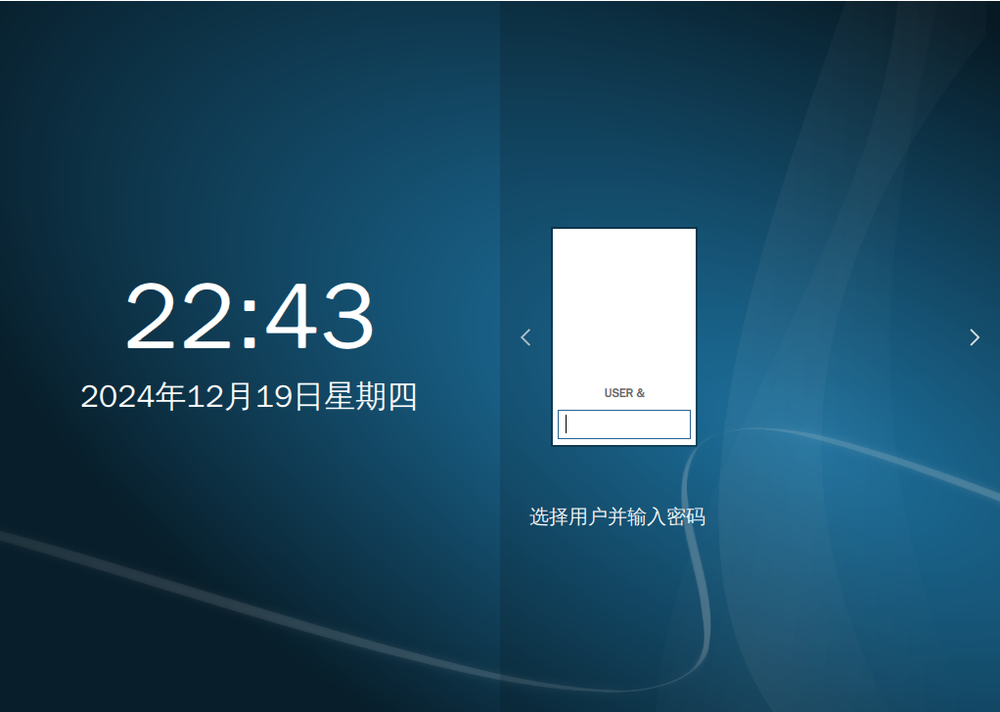

## 迈进 Wayland

Wayland 是取代 X11 的显示服务器协议，KDE Plasma 自 Plasma 5.4 起逐步完善了 Wayland 支持；自 Plasma 6.8 起，Plasma 不再提供 X11 会话，X11 应用改由 Xwayland 承载。

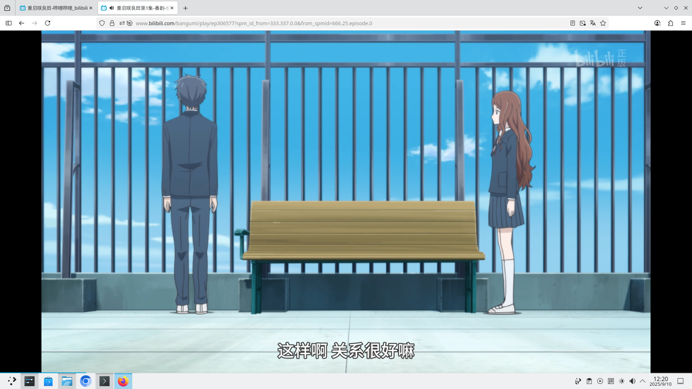

### 参考文献

- KDE Blogs. Going all-in on a Wayland future[EB/OL]. [2026-11-19]. <https://blogs.kde.org/2025/11/26/going-all-in-on-a-wayland-future/>. KDE 博客，说明 Plasma 6.8 起不再包含 X11 会话，X11 应用交由 Xwayland 运行，KDE 对 X11 会话的支持延续至 2027 年初。

## 权限设置

普通用户还须加入 `wheel` 组与 `video` 组，否则部分设置无法显示，图形界面功能可能受限：

```sh
# pw groupmod wheel -m 用户名
# pw groupmod video -m 用户名
```

另外，为了音频功能正常，还需要将用户加入 audio 组：

```sh
# pw groupmod audio -m 用户名
```

将“用户名”替换为实际用户名。

## KDE 桌面环境安装

> **技巧**
>
> 不希望捆绑安装大量附加工具和软件的用户可使用附录部分的最小化安装方案，无需自定义配置的用户可继续使用本方案。

- 使用 pkg 安装：

```sh
# pkg install kde wqy-fonts
```

> **技巧**
>
> 如果提示 `pkg` 未找到该命令或未提供 kde 软件包，可能是二进制包尚未构建完成，或需切换软件源分支。参考本书其他相关章节。如无二进制包，则需使用 Ports 编译安装。

- 或使用 Ports 安装：

```sh
# cd /usr/ports/x11/kde/ && make install clean
# cd /usr/ports/x11-fonts/wqy/ && make install clean
```

### 软件包说明

| 包名 | 作用 |
| ---- | ---- |
| `kde` | KDE 桌面环境 |
| `wqy-fonts` | 文泉驿中文字体 |

Wayland 会话中的 X11 应用由 Xwayland 承载。若系统未自动安装，可执行以下命令补充：

```sh
# pkg install xwayland
```

## seatd 服务

seatd 是一款 seat 管理守护进程，用于非 systemd 环境下管理 Wayland 会话和设备访问。

### 安装 seatd

- 使用 pkg 安装：

```sh
# pkg install seatd
```

- 或通过 Ports 安装：

```sh
# cd /usr/ports/sysutils/seatd/
# make install clean
```

### 配置 seatd 服务

添加并启用服务：

```sh
# service dbus enable # 设置 D-Bus 服务开机自启
# service seatd enable # 设置 Seatd 服务开机自启
```

其中，D-Bus 用于桌面环境的进程间通信，作为依赖项自动安装。

### 参考文献

- Euroquis. KDE Plasma 6 Wayland on FreeBSD[EB/OL]. [2026-03-25]. <https://euroquis.nl/kde/2025/09/07/wayland.html>. 提供了在 FreeBSD 上配置 KDE Plasma 6 Wayland 会话的技术指南，明确指出 seatd 服务的必要性。

## 启动 KDE 6

有多种方法可以启动 Wayland KDE。显示管理器建议使用 SDDM 或 Ly。

当使用显示管理器启动 KDE 时，在登录界面对应位置需要选择“Wayland”会话，显示管理器的配置另见 12.2 节。

若采用 SDDM，先启用其服务：

```sh
# service sddm enable
```

### 通过脚本启动桌面

- 在 **~/** 下新建脚本 `kde.sh`：

```sh
#!/bin/sh
/usr/local/bin/ck-launch-session /usr/local/lib/libexec/plasma-dbus-run-session-if-needed /usr/local/bin/startplasma-wayland # 启动桌面的命令
```

其中 `ck-launch-session` 由 consolekit2 提供。

- 授予 **~/kde.sh** 可执行权限：

```sh
$ chmod 755 ~/kde.sh
```

> **注意**
>
> 需要停止 SDDM 服务才能使用该脚本。检查 **/etc/rc.conf** 是否存在 `sddm_enable="YES"` 字样，如有则删除。按快捷键 Ctrl+Alt+F2 进入 TTY，登录 root 后输入 `service sddm stop` 停止 SDDM 服务。

- 进入 KDE

此时应在 TTY 界面以普通用户身份登录，且没有任何 X11 会话正在运行（如存在，请禁用相关服务并重启再试）。

```sh
$ sh ~/kde.sh
```

## 图示

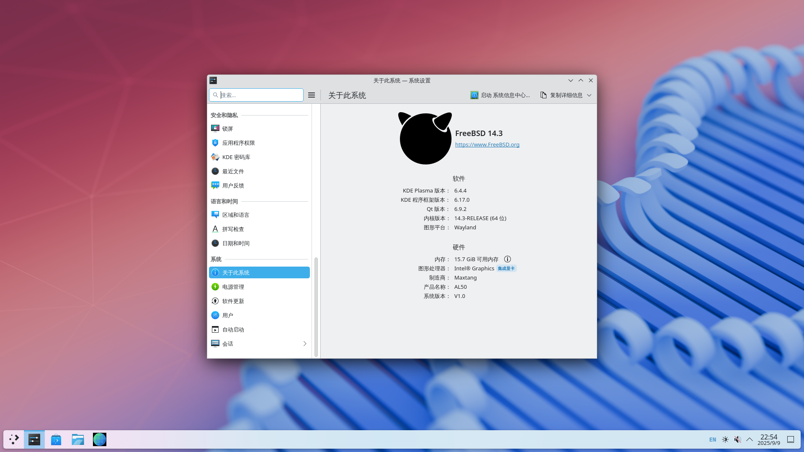

> **技巧**
>
> 上图显示为“Intel UHD Graphics”而非“Iris Xe Graphics”，这是因为系统未启用某些硬件加速特性（与内存配置有关）。~~无力购买第二根 DDR5 内存条。~~ 参见：Intel® Iris® Xe Graphics Shows As Intel® UHD Graphics in the Intel® Graphics Command Center and Device Manager[EB/OL]. [2026-03-26]. <https://www.intel.com/content/www/us/en/support/articles/000059744/graphics.html>（网站对应页面的中文翻译不准确）。

- 显示当前会话类型（如 X11 或 Wayland）

```sh
$ echo $XDG_SESSION_TYPE
```

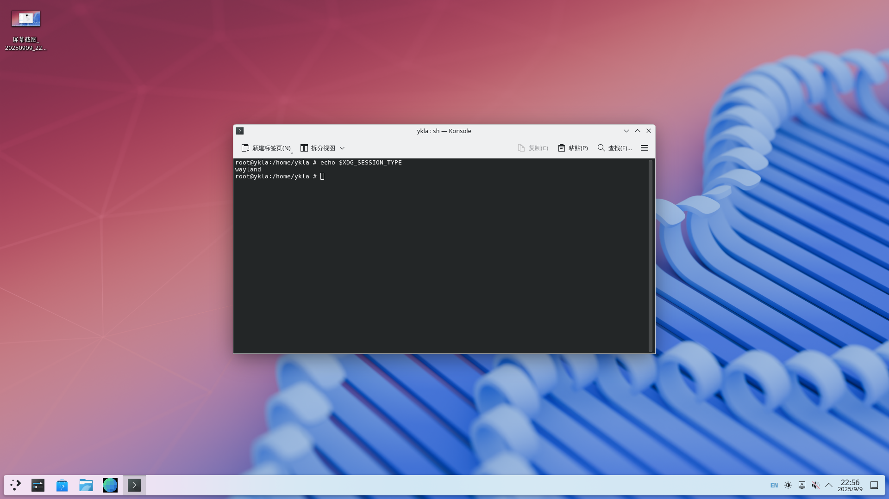

## 配置中文环境

除了通过用户分级设置中文环境外，还可以通过以下方式设置中文环境。

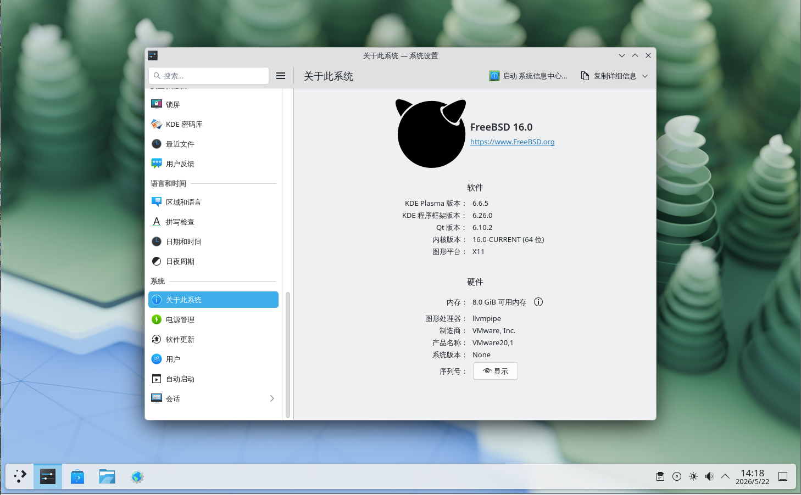

### 通过 KDE 系统设置中文环境

点击应用程序启动器 → System Settings → Language & Time，在 Region & Language 的 Language 栏点击 Modify，找到并选择“简体中文”。如果显示为 `□□□□`，请检查中文字体是否已安装。随后单击 Apply 按钮；注销后重新登录，此时系统语言将切换为中文。

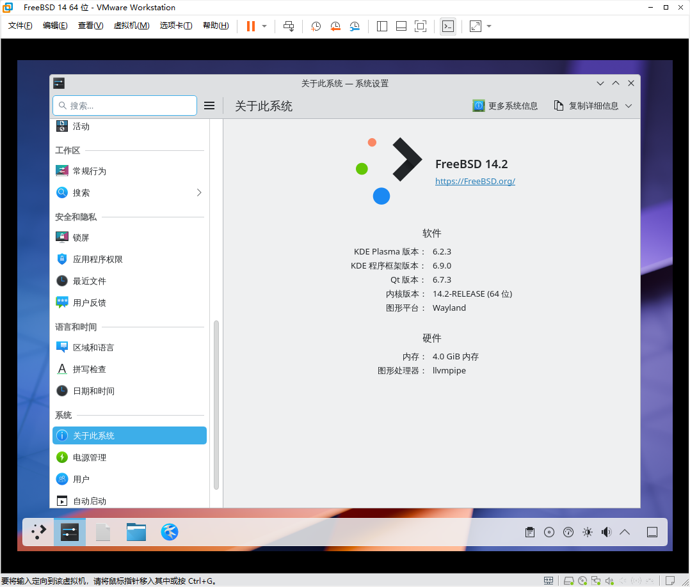

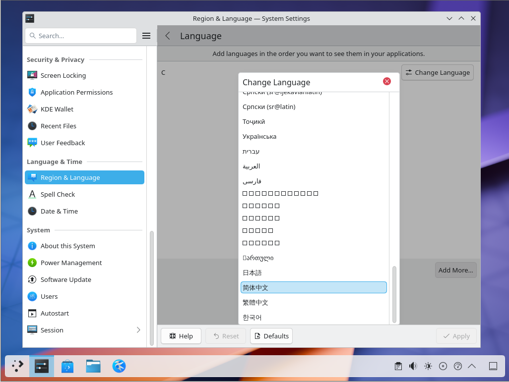

### 参考文献

- silversack. デスクトップ 環境 の 構築 - 4-7. LXQT のインストールと 設定 (LXQT 2.0.0)[EB/OL]. [2026-03-25]. <https://silversack.my.coocan.jp/bsd/fbsd11x_bde-4-7_lxqt.htm>. 日文 FreeBSD 桌面环境构建指南中 LXQt 的安装与配置部分。

## Fcitx 5 输入法框架配置

配置 Fcitx 5 自动启动：

```sh
$ mkdir -p ~/.config/autostart/ # 创建自启动目录
$ cp /usr/local/share/applications/org.fcitx.Fcitx5.desktop ~/.config/autostart/ # 系统启动时自动启动 Fcitx 5
```

初次进入 KDE Wayland 桌面时，KDE 会在右下角提示需在系统设置的虚拟键盘中完成配置后方可启用输入法。须留意该提示。如未完成此设置，将无法切换输入法或输入中文。

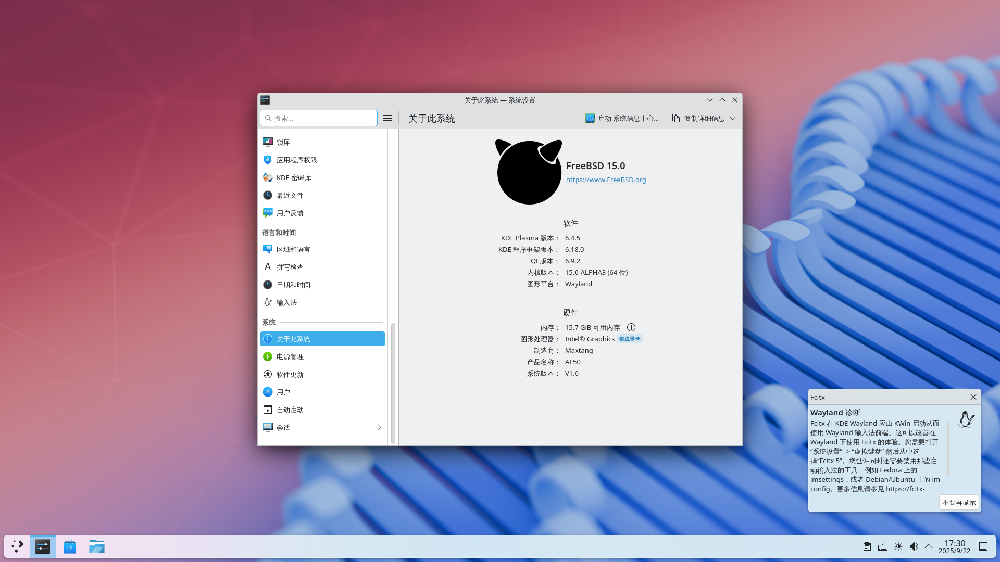

打开 KDE 系统设置：找到“键盘”→“虚拟键盘”

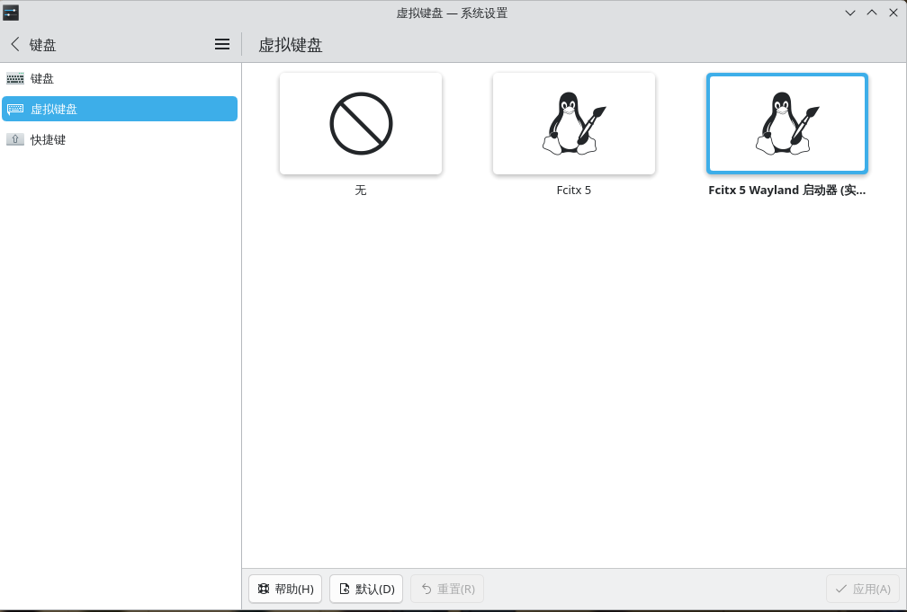

选择“Fcitx 5 Wayland 启动器（实验性）”

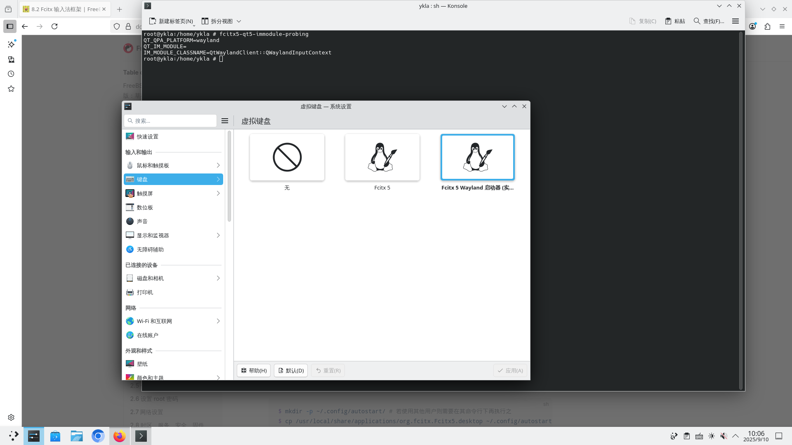

在 Konsole 终端、Firefox 和 Chromium（以 root 身份运行时须加 `--no-sandbox`，不建议日常以 root 运行）中均可输入中文。

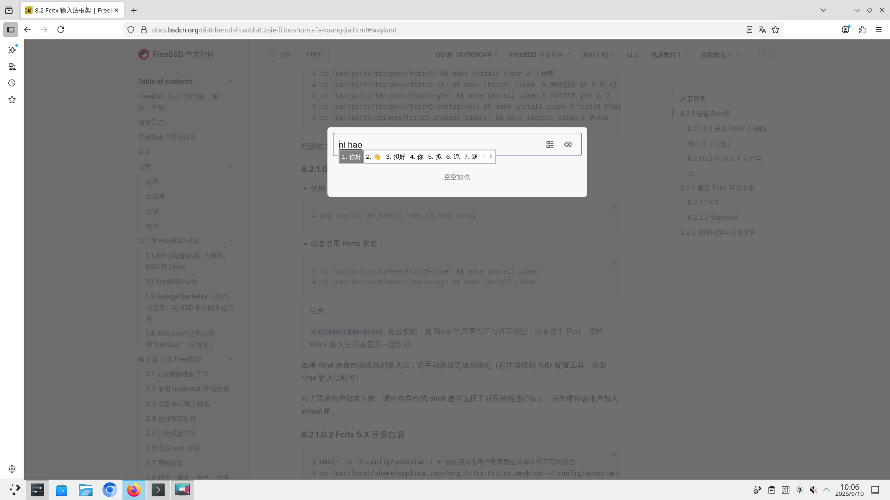

## 附录：展开任务栏图标

右键单击桌面空白处，点击“进入编辑模式”。

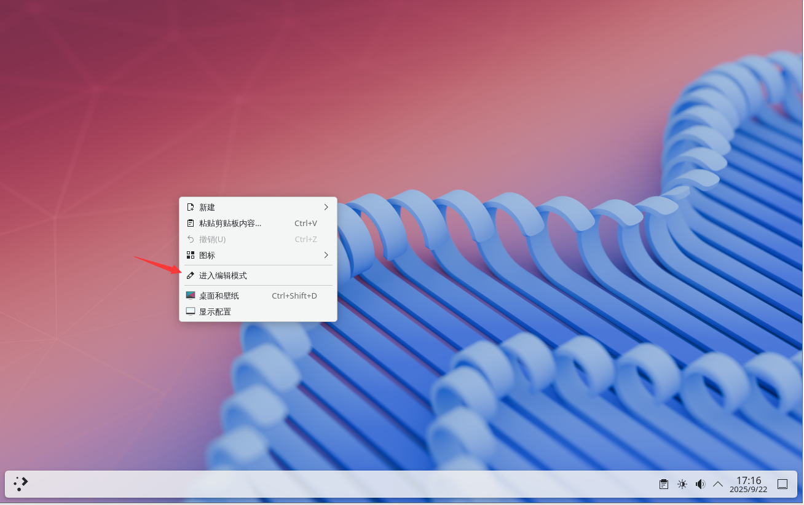

点击任务栏中间的空白处，随后点击“显示替代部件”。

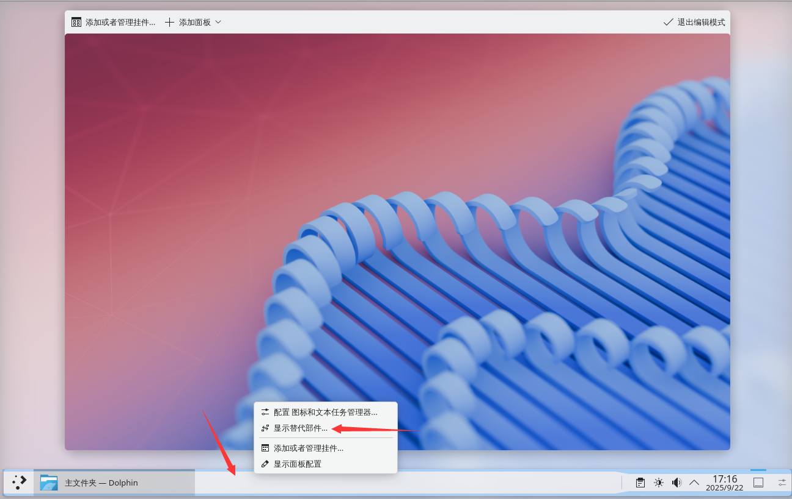

在弹出窗口中选择“图标和文本任务管理器”。

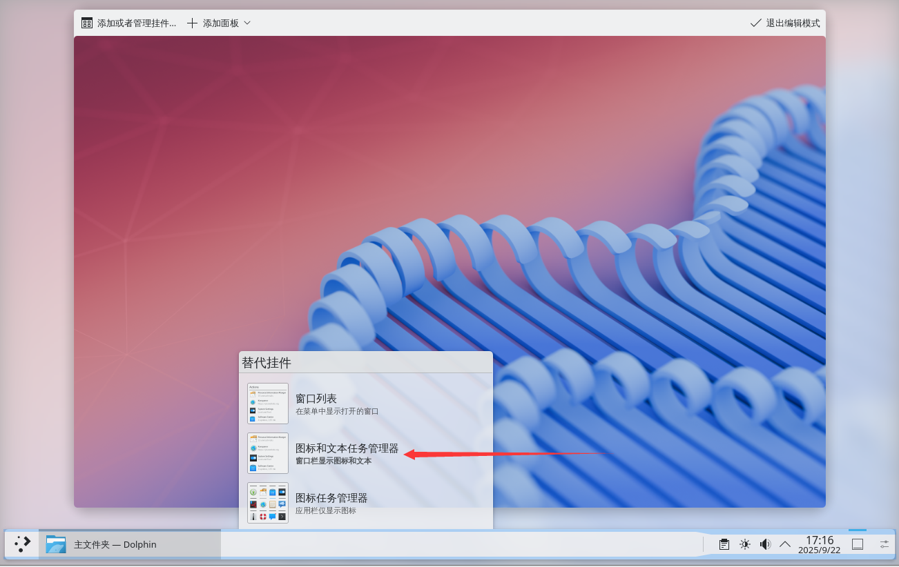

## 附录：解决开机时自动打开特定程序

打开设置，选择“会话”→“桌面会话”，在右侧的“会话恢复”中，修改为“启动为空会话”。最后点击右下角的“应用”保存即可。

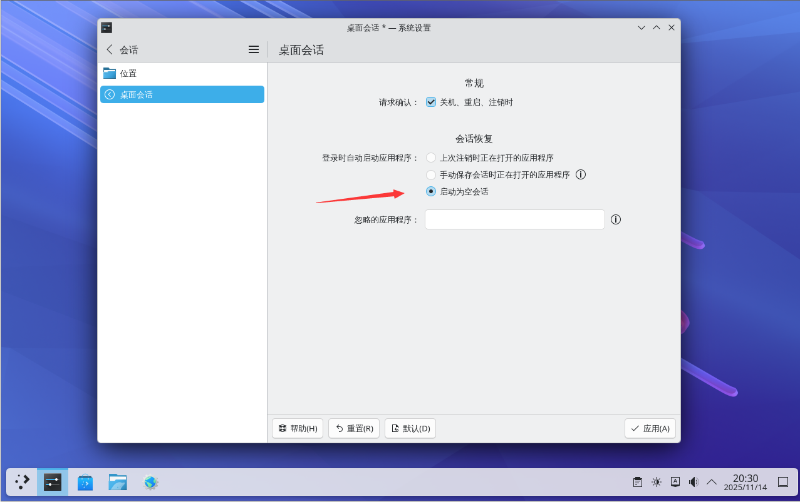

## 附录：最小化 KDE 桌面安装方案

直接安装 **x11/kde** 会将 Plasma 桌面各组件和 **x11/kde-baseapps** 作为依赖一并安装，其中捆绑了大量工具软件，在某些场景下不便于部署和使用。

### 使用 pkg 安装

基础桌面安装方案。

```sh
# pkg install sddm plasma6-plasma-desktop plasma6-sddm-kcm wqy-fonts plasma6-kactivitymanagerd plasma6-kscreen plasma6-systemsettings
```

| 软件包 | 作用 |
| ------ | ---- |
| **plasma6-kactivitymanagerd** | 管理用户活动、跟踪使用模式等的系统服务。缺少该服务可能导致 KDE 桌面无法正常显示 |
| **plasma6-kscreen** | KDE 屏幕管理器。**未安装该软件将无法调整分辨率** |
| **plasma6-sddm-kcm** | SDDM 配置模块，用于在系统设置中配置 SDDM |
| **plasma6-systemsettings** | 系统设置 |

与上文重复的软件包在此不再列出。

可选软件包：

```sh
# pkg install konsole dolphin kate plasma6-plasma-systemmonitor plasma6-plasma-pa plasma6-discover kdeconnect-kde plasma6-plasma-workspace-wallpapers plasma6-plasma-disks ark
```

| 软件包 | 作用 |
| ------ | ---- |
| **konsole** | 终端命令行工具 |
| **dolphin** | 文件管理器 |
| **kate** | 文本编辑器 |
| **plasma6-plasma-systemmonitor** | 系统监视器 |
| **plasma6-plasma-pa** | 音频管理 |
| **plasma6-discover** | 软件管理 |
| **kdeconnect-kde** | 移动设备与桌面互联 |
| **plasma6-plasma-workspace-wallpapers** | 桌面壁纸 |
| **plasma6-plasma-disks** | 磁盘健康（S.M.A.R.T.）监测 |
| **ark** | 解压缩软件 |

### 使用 Ports 安装

基础桌面安装方案。

```sh
# cd /usr/ports/x11/plasma6-plasma-desktop/ && make install clean
# cd /usr/ports/deskutils/plasma6-sddm-kcm/ && make install clean
# cd /usr/ports/x11/sddm/ && make install clean
# cd /usr/ports/x11-fonts/wqy/ && make install clean
# cd /usr/ports/x11/plasma6-kscreen/ && make install clean
# cd /usr/ports/x11/plasma6-kactivitymanagerd/ && make install clean
# cd /usr/ports/sysutils/plasma6-systemsettings/ && make install clean
```

可选 Ports：

```sh
# cd /usr/ports/x11/konsole/ && make install clean # 终端
# cd /usr/ports/x11-fm/dolphin/ && make install clean # 文件管理器
# cd /usr/ports/editors/kate/ && make install clean # 文本编辑器
# cd /usr/ports/sysutils/plasma6-plasma-systemmonitor/ && make install clean # 系统监视器
# cd /usr/ports/audio/plasma6-plasma-pa/ && make install clean # 音频管理器
# cd /usr/ports/sysutils/plasma6-discover/ && make install clean # 软件管理器
# cd /usr/ports/deskutils/kdeconnect-kde/ && make install clean # 移动设备与桌面互联
# cd /usr/ports/x11-themes/plasma6-plasma-workspace-wallpapers/ && make install clean # 桌面壁纸
# cd /usr/ports/sysutils/plasma6-plasma-disks/ && make install clean # 磁盘健康（S.M.A.R.T.）监测
# cd /usr/ports/archivers/ark/ && make install clean # 解压缩软件
```

### 最小化安装 KDE 图示

> **技巧**
>
> 使用此方案安装的 KDE 桌面缺少较多功能，可参照 [x11/plasma6-plasma](https://www.freshports.org/x11/plasma6-plasma/) 的“Runtime dependencies”（运行时依赖）和“Library dependencies”（库依赖）来补全功能。

未安装可选包：

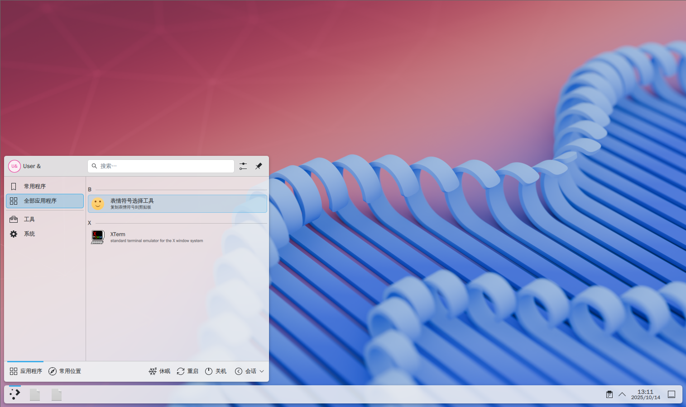

## 故障排除与未竟事宜

### 以 root 账户登录时没有声音

表现为右下角声音控件提示“未连接到音频服务”。可设置 PulseAudio 自启动：于 KDE 设置中添加该服务并赋予可执行权限。

### 菜单缺少关机、重启等选项

修改 **/etc/sysctl.conf** 文件，将其中 `security.bsd.see_other_uids` 的值改为 `1`。重启后即可。`1` 为开启，该值默认为 `1`，可能由于在安装过程中错误地设置了该安全加固选项。

### 解除自动锁屏

单击“设置”→“安全和隐私”→“锁屏”→“自动锁定屏幕”选择“不自动锁屏”，随后点击“应用”。（休眠唤醒后锁定屏幕可按需设置）

注销后重新登录即可。

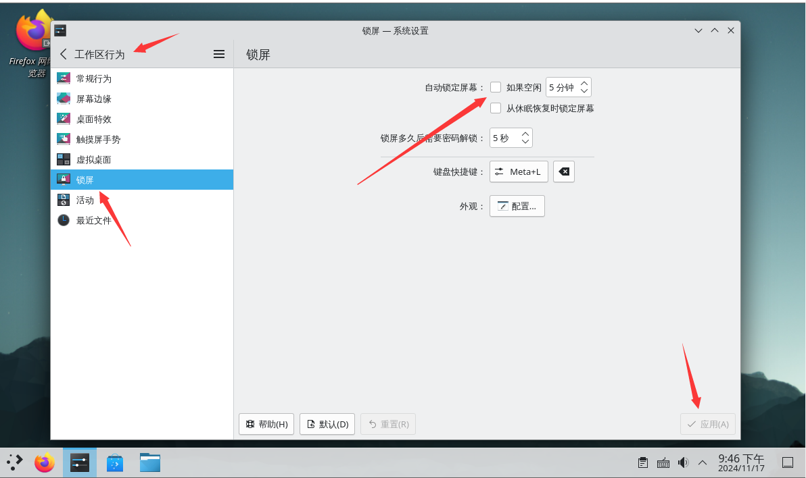

### 状态栏不显示时间和日期

打开时区设置，选择“Asia/Shanghai”时区即可。如果仍无效，请先更新相关软件包。

### 参考文献

- FreeBSD Forums. Missing power buttons when logged in from SDDM[EB/OL]. [2026-03-25]. <https://forums.freebsd.org/threads/missing-power-buttons-when-logged-in-from-sddm.88231/>. FreeBSD 官方论坛讨论，解决 SDDM 登录后电源按钮缺失的技术问题。
